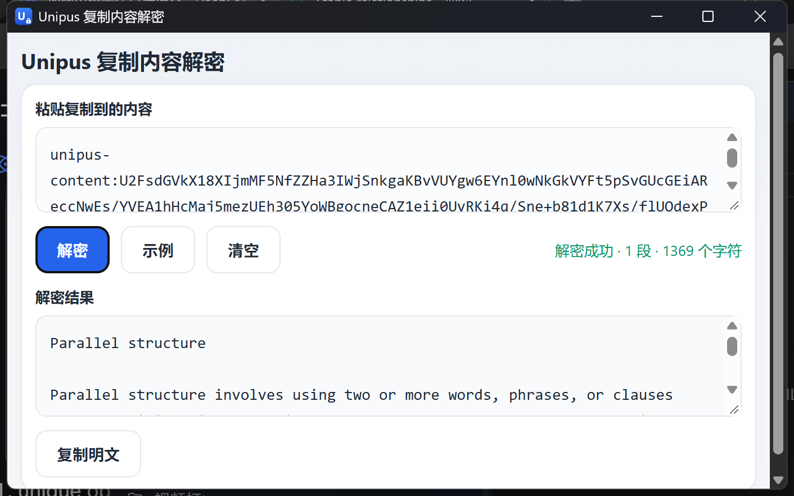

# UnipusToNaked（Unipus 复制内容解密）

GitHub: https://github.com/Hayuuka/UnipusToNaked

## 下载

编译好的单文件 exe 见 [Releases](https://github.com/Hayuuka/UnipusToNaked/releases)。



把 Unipus 网页复制出来的 `unipus-content:...` 还原成正常文字的小工具。
网页本身用 AES 加密剪贴板内容，密钥固定写在它的前端脚本里（`unipus`），
本工具只是按同样的规则在本地解密，不上传任何内容。

## 功能

- 粘贴一段或多段 `unipus-content:...`，自动逐段解密
- 一键复制解密结果
- 完全离线：CryptoJS 已打包在 `web/` 中
- 单文件 exe，双击即用，无需安装 Python

## 目录结构

```
UnipusToNaked/
├─ app.py               # 桌面启动器（pywebview）
├─ web/
│  ├─ index.html        # 界面与解密逻辑
│  └─ crypto-js.min.js  # 本地解密库
├─ tools/make_icon.py   # 生成 icon.ico
├─ icon.ico / icon.png
├─ requirements.txt
├─ build.ps1            # 一键打包
└─ dist/                # 打包输出
   └─ UnipusToNaked.exe
```

## 开发运行

```powershell
pip install -r requirements.txt
python app.py
```

## 打包 exe

```powershell
powershell -ExecutionPolicy Bypass -File .\build.ps1
```

输出：`dist\UnipusToNaked.exe`

## 说明

- 程序使用 Windows 自带的 **Microsoft Edge WebView2** 渲染界面。
  Windows 10/11 一般已自带；如提示缺失，可安装：
  https://developer.microsoft.com/microsoft-edge/webview2/
- PyInstaller 单文件程序偶尔会被杀毒软件误报，可把 exe 加入信任，
  或直接用源码运行 `python app.py`。
- 仅用于还原自己有权访问的课程内容。